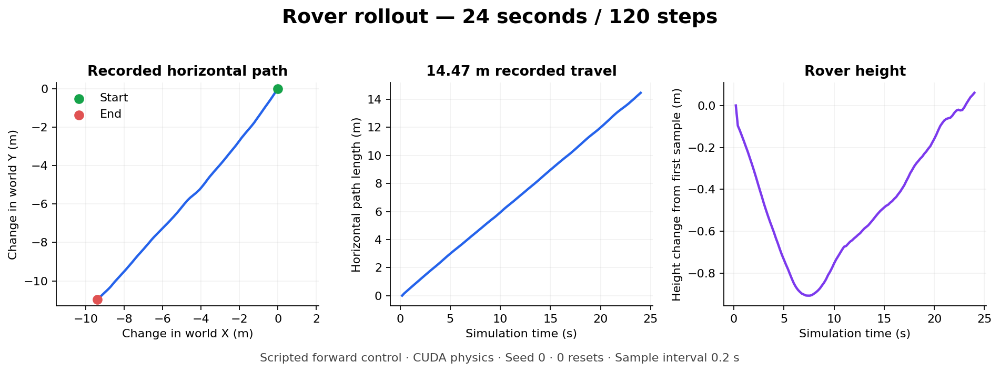

<p align="center">
  
</p>

<h1 align="center">MarsRover-WM</h1>
<p align="center">Learn the terrain. Predict the motion. Plan the route.</p>
<p align="center">
  <a href="docs/README.md">Documentation</a> ·
  <a href="docs/getting-started.md">Getting started</a> ·
  <a href="docs/results.md">Results</a> ·
  <a href="docs/roadmap.md">Roadmap</a>
</p>

## About

MarsRover-WM is a research project for rover navigation with learned world
models. A world model predicts how an environment changes when an agent takes
an action. This project brings together **JEPA-WMs**, which predicts in a learned
feature space, and **RLRoverLab**, which simulates rover motion in Isaac Sim.

The project has scripted rover motion, recorded training data, and a small
predictor trained on local CPU from Nautilus recordings. The learned-model
planner reached native goals in Isaac Sim on both debug and Mars terrain.
The scan-aware planner reached four of six goals with no collisions on both
the original cases and six fresh cases. Two cases in each set still timed out.

## Goal

Train an action-conditioned model that predicts rover motion across unfamiliar
terrain, then use those predictions to choose commands toward a goal. Measure
prediction error, goal progress, collisions, and performance across terrain and
friction conditions. Add physical constraints after a baseline works.

```text
Terrain + rover observations + commands
                  ↓
         Predict future motion
                  ↓
       Choose a route toward a goal
```

## Results so far

| Check | Result |
| :--- | :--- |
| Headless rover simulation | **120 steps** on an NVIDIA A40; exit code 0 |
| Recorded motion | **24 s** simulated time · **14.47 m** horizontal path · **0 resets** |
| Rover training data | **24,000 raw rows** across original and new recordings; 6,000 new rows reserved for final testing; RGB not recorded |
| Reference JEPA planning | Deployment repaired and validated; full rerun still needed |
| Rover world-model training | Goal-motion model beats copying at one and five steps on held-out recordings |
| Rover JEPA training | Meta DINO-WM rover predictor passed development and pooled reserved-test checks; final feature error 10.8% / 19.9% below copying at 1 / 5 seconds; 18,000 new rows collected |
| Closed-loop rover navigation | **4/6 native goals reached**, versus **2/6** for the original planner and **0/6** for forward motion, on each of two six-case sets; no scan-aware collisions |

<p align="center">
  
</p>

The first motion result uses a scripted forward command. The later
[closed-loop evaluation](docs/results.md#scan-aware-navigation) uses the
trained model to choose commands. The plot shows measured
simulator positions. RGB camera capture is still unverified. See
[results and evidence](docs/results.md) for the run details and current limits.

## Run the reference checks

With Nautilus access, the published runtime image, and the existing shared
storage configured:

```bash
rtk proxy bash deploy/nautilus-reference/deploy.sh
rtk kubectl --context nautilus -n razvanlab logs -f job/mars-jepa-step1 -c setup
```

The job checks checkpoint loading, inspects a PointMaze sample, and runs two
planning episodes. **The current run failed during dependency setup.** Follow the
[Step 1 guide](deploy/nautilus-reference/README.md) and [status notes](docs/results.md#reference-planning)
before retrying. The installer now overrides the failing dependencies. A full rerun is still
needed. The deploy script protects an existing job from replacement.

For the rover simulator and the local CPU prototype, see
[getting started](docs/getting-started.md).

## Project map

```text
deploy/       Nautilus jobs, simulator recording, and runtime setup
docker/       Shared runtime image and preflight checks
scripts/      Reference checks, recording, training, and planning
tests/        Deployment and recording checks
docs/         Guides, results, roadmap, and illustrations
notes/        Run history and upstream revision pins
external/     Local upstream source snapshots (not versioned here)
```

## Documentation

| Guide | Contents |
| :--- | :--- |
| [Getting started](docs/getting-started.md) | Execution hosts, environments, and run commands |
| [System overview](docs/architecture.md) | Simulator, data, model, and planning stages |
| [Results](docs/results.md) | Measured motion, evidence, and open blockers |
| [Roadmap](docs/roadmap.md) | The next three steps toward a rover world model |
| [Nautilus deployment](deploy/nautilus/README.md) | Images, resources, storage, and simulator jobs |
| [Requirements](REQUIREMENTS.md) | Acceptance checks and project scope |

## Built on

[JEPA-WMs](https://github.com/facebookresearch/jepa-wms) ·
[RLRoverLab](https://github.com/abmoRobotics/RLRoverLab) ·
[Isaac Lab](https://github.com/isaac-sim/IsaacLab) ·
[NRP Nautilus](https://nrp.ai/)

[MarsExplorer-Gymnasium](https://github.com/markub3327/MarsExplorer-Gymnasium)
provides the optional 2D CPU prototype. Upstream source revisions are recorded in
[`notes/upstream.json`](notes/upstream.json).
