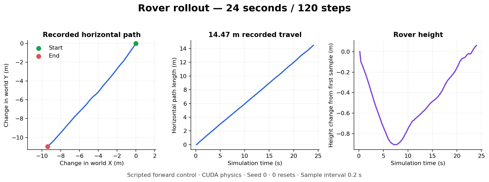

<p align="center">
  
</p>

<h1 align="center">MarsRover-WM</h1>
<p align="center">Learn the terrain. Predict the motion. Plan the route.</p>
<p align="center">
  <a href="docs/README.md">Documentation</a> ·
  <a href="docs/getting-started.md">Getting started</a> ·
  <a href="docs/results.md">Results</a> ·
  <a href="docs/roadmap.md">Roadmap</a>
</p>

## About

MarsRover-WM is a research project for rover navigation with learned world
models. A world model predicts how an environment changes when an agent takes
an action. This project brings together **JEPA-WMs**, which predicts in a learned
feature space, and **RLRoverLab**, which simulates rover motion in Isaac Sim.

The project is at the simulator and reference-evaluation stage. A scripted rover
run works on NRP Nautilus. Rover world-model training is the next development phase.

## Goal

Train an action-conditioned model that predicts rover motion across unfamiliar
terrain, then use those predictions to choose commands toward a goal. Measure
prediction error, goal progress, collisions, and performance across terrain and
friction conditions. Add physical constraints after a baseline works.

```text
Terrain + rover observations + commands
                  ↓
         Predict future motion
                  ↓
       Choose a route toward a goal
```

## Results so far

| Check | Result |
| :--- | :--- |
| Headless rover simulation | **120 steps** on an NVIDIA A40; exit code 0 |
| Recorded motion | **24 s** simulated time · **14.47 m** horizontal path · **0 resets** |
| Reference JEPA planning | Deployed; setup blocked by an upstream Metaworld branch reference |
| Rover world-model training | Not started |

<p align="center">
  
</p>

The motion result uses a scripted forward command. The plot shows measured
simulator positions. RGB camera capture is still unverified. See
[results and evidence](docs/results.md) for the run details and current limits.

## Run the reference checks

With Nautilus access, the published runtime image, and the existing shared
storage configured:

```bash
rtk proxy bash src/step1/deploy.sh
rtk kubectl --context nautilus -n razvanlab logs -f job/mars-jepa-step1 -c setup
```

The job checks checkpoint loading, inspects a PointMaze sample, and runs two
planning episodes. **The current run failed during dependency setup.** Follow the
[Step 1 guide](src/step1/README.md) and [status notes](docs/results.md#reference-planning)
before retrying. The deploy script protects an existing job from replacement.

For the rover simulator and the local CPU prototype, see
[getting started](docs/getting-started.md).

## Project map

```text
src/step1/     Reference JEPA evaluation and deployment
deploy/       Nautilus jobs, simulator recording, and runtime setup
docker/       Shared runtime image and preflight checks
scripts/      Local setup checks and CPU trajectory recorder
tests/        Deployment and recording checks
docs/         Guides, results, roadmap, and illustrations
notes/        Run history and upstream revision pins
external/     Local upstream source snapshots (not versioned here)
```

## Documentation

| Guide | Contents |
| :--- | :--- |
| [Getting started](docs/getting-started.md) | Execution hosts, environments, and run commands |
| [System overview](docs/architecture.md) | Simulator, data, model, and planning stages |
| [Results](docs/results.md) | Measured motion, evidence, and open blockers |
| [Roadmap](docs/roadmap.md) | The next three steps toward a rover world model |
| [Nautilus deployment](deploy/nautilus/README.md) | Images, resources, storage, and simulator jobs |
| [Requirements](REQUIREMENTS.md) | Acceptance checks and project scope |

## Built on

[JEPA-WMs](https://github.com/facebookresearch/jepa-wms) ·
[RLRoverLab](https://github.com/abmoRobotics/RLRoverLab) ·
[Isaac Lab](https://github.com/isaac-sim/IsaacLab) ·
[NRP Nautilus](https://nrp.ai/)

[MarsExplorer-Gymnasium](https://github.com/markub3327/MarsExplorer-Gymnasium)
provides the optional 2D CPU prototype. Upstream source revisions are recorded in
[`notes/upstream.json`](notes/upstream.json).
