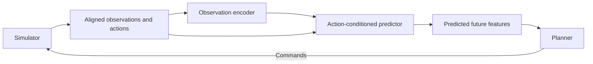

# System overview

The project has two independent runtime paths. RLRoverLab runs a rover in
Isaac Sim. JEPA-WMs provides the reference model and PointMaze planner. The rover
and JEPA environments stay separate because they use different Python and
simulation dependencies.

## Current components

| Component | Role | Current state |
| :--- | :--- | :--- |
| RLRoverLab / Isaac Sim | Run 3D rover physics | Scripted headless motion verified on an A40 |
| Rover recorder | Save positions, rewards, and reset flags | Position trace verified; training observations/actions still needed |
| JEPA reference job | Load a model, inspect data, evaluate planning | Implemented; dependency setup blocked |
| MarsExplorer | Optional local 2D prototype | Recorder exists; local runtime remains unverified |
| Shared storage | Keep data, weights, logs, and results | Nautilus `mars-world-data` volume |

## Planned model pipeline

The encoder maps observations into a compact set of features. The predictor uses
those features and candidate actions to estimate future features. The planner
compares possible futures and chooses commands toward a goal. Rover integration
and this control loop are future work.

Save each transition as `observation[t], action[t], observation[t+1]`. Keep time,
episode boundaries, goals, and outcomes with it. Keep simulator-only diagnostics
separate from inputs that a navigation agent could measure.

## Runtime and storage

Jobs install pinned upstream source in temporary `/runtime` storage. The shared
runtime image supplies system tools and libraries. A ConfigMap supplies the
current Step 1 scripts without an image rebuild.

| Path on Nautilus | Contents |
| :--- | :--- |
| `/runtime/` | Temporary source, environments, and installed packages |
| `/data/datasets/` | Reference data and future rover datasets |
| `/data/checkpoints/` | Model weights |
| `/data/runs/setup/<pod>/` | Installation logs and package versions |
| `/data/runs/jepa/<pod>/` | Reference checks, config, and planning results |
| `/data/runs/rover-video/` | Recorded rover motion artifacts |

Deleting a pod removes its temporary runtime. Results on shared storage remain.
Deleting the shared volume can destroy those results. See the
[deployment guide](../deploy/nautilus/README.md) for operational details.
