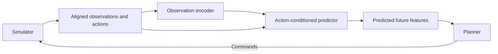

# System overview

The project has two independent runtime paths. RLRoverLab runs a rover in
Isaac Sim. JEPA-WMs provides the reference model and PointMaze planner. The rover
and JEPA environments stay separate because they use different Python and
simulation dependencies.

## Current components

| Component | Role | Current state |
| :--- | :--- | :--- |
| RLRoverLab / Isaac Sim | Run 3D rover physics | Scripted headless motion verified on an A40 |
| Rover recorder | Save observations, actions, rewards, and episode boundaries | 24,000 raw rows across original and new recordings; six new collection seeds complete |
| JEPA reference job | Load a model, inspect data, evaluate planning | Deployment repaired; full dependency/setup rerun still needed |
| Goal-motion baseline | Predict movement from current and previous commands | Beats copying on available held-out goal fields; terrain inputs not used |
| Rover JEPA predictor | Predict future terrain features using a frozen DINOv2 encoder and Meta predictor | 167,904 trainable parameters; motion baseline aligns past terrain; offline development checks in progress |
| Rover planner | Follow a scan-derived route with learned motion predictions | 4/6 goals on both original and fresh cases; no scan-aware collisions |
| MarsExplorer | Optional local 2D prototype | Recorder exists; local runtime remains unverified |
| Shared storage | Keep data, weights, logs, and results | Nautilus `mars-world-data` volume |

## Repository layout

```text
src/                        Terrain readout, forecast history, and terrain generation
scripts/                    Reference checks, data tools, training, and planning
deploy/nautilus-reference/   Reference job, launcher, run sequence, and guide
deploy/nautilus-*/           Other Nautilus workloads and their setup
tests/                      Checks for script and deployment interfaces
external/                   Pinned upstream model and simulator code
```

Run local Python tools from `scripts/`. Keep cluster configuration and shell
launchers in the matching `deploy/` folder. The reference launcher's interface
is `bash deploy/nautilus-reference/deploy.sh`. It mounts the Python scripts
without rebuilding the image. `src/terrain_cost.py` holds the new model code;
operational entry points stay in `scripts/`.

The separate [architecture pilot](https://github.com/sameeerkashyap/mars-world-rover/pull/10) compares upstream AdaLN and DINO-WM predictors.

The terrain-cost trainer keeps the selected JEPA predictor and DINOv2 encoder
frozen. It fits a 65-parameter readout to blocked-area fractions from recorded
height scans. Labels use the existing planner's clearance rules. Validation
compares predicted costs at one and five seconds with copying features,
motion-only feature transport, and a fixed cost per patch. These are offline
checks. `src/rover_forecast.py` now supplies optional terrain costs to rerank
candidate paths that pass the measured-scan checks. The frozen
[navigation comparison](../deploy/nautilus-jepa-navigation/README.md) measures
goal completion, collisions, stalls, path length, and planning latency before
any claim that these costs improve navigation.

## Planned model pipeline



The encoder maps observations into a compact set of features. The predictor uses
those features and candidate actions to estimate future features. The planner
compares possible futures and chooses commands toward a goal. The small
goal-motion model closes the control loop. Optional frozen DINO-WM rover
forecasts now add terrain costs to the planner. Their motion forecasts come
from the frozen motion baseline. The measured height-scan rules still reject
blocked paths. See the [training guide](../deploy/nautilus-jepa-rover/README.md).
The current height rules are a geometric approximation.

Save each transition as `observation[t], action[t], observation[t+1]`. Keep time,
episode boundaries, goals, and outcomes with it. Keep simulator-only diagnostics
separate from inputs that a navigation agent could measure.

## Runtime and storage

Jobs install pinned upstream source in temporary `/runtime` storage. The shared
runtime image supplies system tools and libraries. A ConfigMap supplies the
current Step 1 scripts without an image rebuild.

| Path on Nautilus | Contents |
| :--- | :--- |
| `/runtime/` | Temporary source, environments, and installed packages |
| `/data/datasets/` | PointMaze data and the rover starter dataset |
| `/data/checkpoints/` | Model weights |
| `/data/runs/setup/<pod>/` | Installation logs and package versions |
| `/data/runs/jepa/<pod>/` | Reference checks, config, and planning results |
| `/data/runs/rover-video/` | Recorded rover motion artifacts |

Deleting a pod removes its temporary runtime. Results on shared storage remain.
Deleting the shared volume can destroy those results. See the
[deployment guide](../deploy/nautilus/README.md) for operational details.
