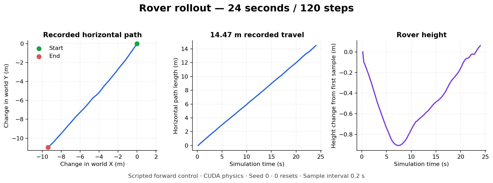

# Results and evidence

The verified result is scripted rover motion in a 3D simulator. There is no
rover-trained world model or measured world-model navigation result yet.

## Rover motion

The recorded run used `AAURoverEnvSimple-v0`, seed 0, and a scripted forward
command on an NVIDIA A40. It completed on 2026-11-06 UTC.

| Measurement | Value |
| :--- | ---: |
| Recorded steps | 120 |
| Simulated time | 24.0 s |
| Horizontal path between recorded samples | 14.46758 m |
| Net horizontal displacement | 14.43832 m |
| Resets | 0 |
| RGB frames | 0 |



This demonstrates motion and position recording under one scripted command.
It does not measure learned control, prediction accuracy, collision avoidance,
or generalization to new terrain. Camera startup stalled. The saved replay is
a top-down animation of measured positions.

Evidence copied into the documentation:

- [Recorder summary](results/summary.json)
- [Motion metrics](results/motion-metrics.json)
- [Run history](../notes/setup.md)

Full local artifacts are in `runs/rover-video/`: `trajectory.csv`,
`trajectory.png`, `trajectory-replay.mp4`, and the JSON summaries. These generated
files are ignored by Git; the small documentation copies above are included.
The persistent cluster copy is under `/data/runs/rover-video/`.

The earlier independent rover check also completed 120 headless steps with exit
code 0. Its pod was `mars-rover-smoke-rz474` on `bak-hpc1.csub.edu`.

## Reference planning

The first Step 1 deployment failed during setup, before checkpoint loading,
dataset inspection, or planning. Job `mars-jepa-step1` ran pod
`mars-jepa-step1-4dg8d` on `k8s-gpu-1.ucsc.edu`.

The pinned JEPA project requests Metaworld from the Git branch `master`.
The upstream repository no longer provides that branch:

```text
fatal: couldn't find remote ref refs/heads/master
```

Fix and validate this dependency reference before retrying. The existing deploy
script refuses to replace a job. Review the failed job and its logs before
removing it. Keep the shared volume.

```bash
rtk kubectl --context nautilus -n razvanlab logs job/mars-jepa-step1 -c setup
rtk kubectl --context nautilus -n razvanlab get job mars-jepa-step1
```

The setup log is saved under
`/data/runs/setup/mars-jepa-step1-4dg8d/install.log`. No planning success rate is
available from this run.

The configured evaluation uses two episodes, seed 0, three planning iterations,
and 32 candidate action sequences per iteration. Optional decoder heads are
disabled. This is a small functional check; it is not the full paper benchmark.
See the [Step 1 guide](../src/step1/README.md) for expected outputs.

## Local validation

At Step 1 deployment, 10 unit tests passed. The three Step 1 Python files parsed,
the two new shell scripts passed syntax checks, and Nautilus accepted the job
in server-side validation. These checks cover deployment structure and helper
behavior. They do not establish model or navigation performance.
