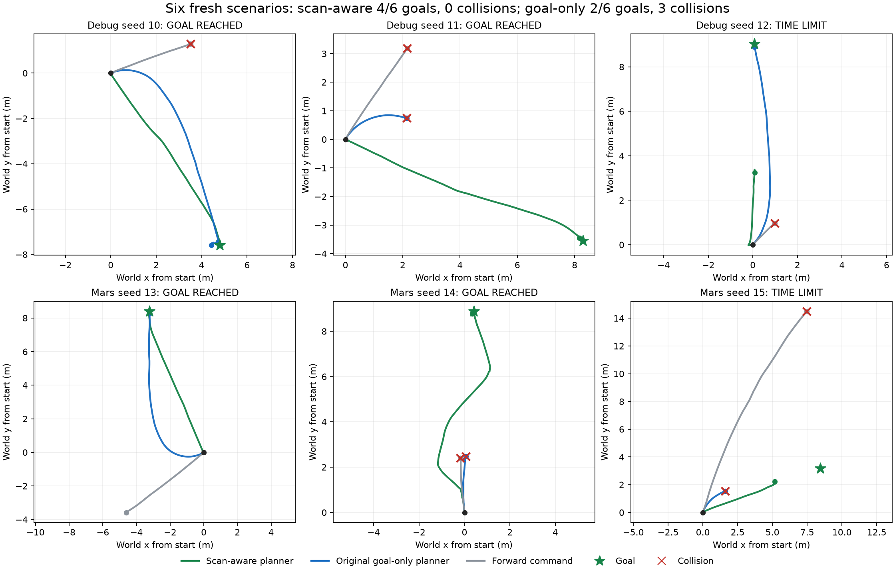

# Results

This page contains consolidated findings from completed evaluations. Pilot
reports, development diagnostics, raw traces, checkpoints, and per-run test
outputs stay in local or external artifact storage outside Git.

## Rover motion

Headless Isaac Sim completed 120 recorded control steps on an NVIDIA A40.
The recorded trajectory spans 24 simulated seconds and 14.47 m, with no resets.
The command was scripted forward motion. No RGB frames were recorded.

This checks motion and position recording. It does not measure learned control,
collision avoidance, or performance on new terrain.

## Goal-motion prediction

The goal-motion model predicts forward, lateral, and yaw movement from current
and previous commands. Training uses Mars seeds 0 and 1. Validation uses debug
seed 1; debug seed 2 supplies a separate development diagnostic. The loader
omits stale reset transitions and wraps angular differences at the circle
boundary. Normalization uses training data only.

The model improves one- and five-step goal prediction over copying the current
goal fields on these recordings. This is development evidence, not a fresh
final test. Motion targets come from goal geometry. Terrain response and wheel
slip remain untested.

## Scan-aware navigation

The planner uses the learned motion model and the policy height scan. Raised
areas, sharp height changes, and unknown cells reject candidate paths. Native
success requires distance below 0.18 m, absolute heading error below 0.1 rad,
and no collision. Independent terminal-trace checks apply the same geometry.

| Cases | Controller | Goals reached | Collisions |
| :--- | :--- | ---: | ---: |
| Original six, seeds 4–9 | Scan-aware | 4/6 | 0/6 |
| Original six, seeds 4–9 | Original goal-only | 2/6 | 4/6 |
| Original six, seeds 4–9 | Forward | 0/6 | 1/6 |
| Fresh six, seeds 10–15 | Scan-aware | 4/6 | 0/6 |
| Fresh six, seeds 10–15 | Original goal-only | 2/6 | 3/6 |
| Fresh six, seeds 10–15 | Forward | 0/6 | 5/6 |

The original cases selected the planner. Source, parameters, and checkpoint
were frozen before the fresh runs. Controller pairs started from identical
measured states. The motion checkpoint SHA256 is
`76953ac81e383a6000d9b26bf8026b5049f4ce768831bd48506dea31d7649283`.

Two scan-aware cases in each set still timed out. The planner does not improve
every case. These small samples use the same two terrain layouts and do not
establish real-rover safety or performance on new terrain classes.

## Rover JEPA prediction

The selected model uses a frozen pretrained DINOv2 ViT-S/14 encoder and Meta's
DINO-WM predictor. Height scans replace RGB. The predictor has 167,904 trainable
parameters. A training-only projection reduces 384 encoder features to 64
channels; evaluation scores all 384 original features. Pose forecasts come
from a frozen motion prior.

Training uses 16,200 raw rows. Development validation and development test each
use 900 rows. Reserved Mars seed 20 and debug seed 21 contribute 6,000 raw rows
to the final test. No fitting uses these reserved recordings. The frozen
checkpoint passed the planned pooled final target.

| Final split | Horizon | Error reduction vs copying | Error reduction vs transport |
| :--- | ---: | ---: | ---: |
| Pooled, 1,135 windows | 1 s | 10.80% | 2.37% |
| Pooled, 1,135 windows | 5 s | 19.88% | 5.65% |
| Mars seed 20, 565 windows | 1 s | 9.85% | 2.06% |
| Mars seed 20, 565 windows | 5 s | 18.72% | 4.28% |
| Debug seed 21, 570 windows | 1 s | 11.63% | 2.64% |
| Debug seed 21, 570 windows | 5 s | 21.00% | 6.96% |

Shuffling future commands increases pooled feature error by 11.81% at one
second and 7.47% at five seconds. Mars alone misses the 10% one-second copy
gain target. These are offline results on existing terrain layouts. They do
not establish a learned-forecast navigation advantage or physical safety.

See the [training guide](../deploy/nautilus-jepa-rover/README.md) for the model,
data split, fixed quality targets, and evaluation procedure.

## Reference planning

No completed reference-planning success rate is available. The runtime
installer repairs the upstream Metaworld branch dependency and overrides
`datasets`; a complete reference run remains required. See the
[reference deployment guide](../deploy/nautilus-reference/README.md).

## Artifact storage

Keep recordings under `/data/datasets/`, model and encoder weights under
`/data/checkpoints/` or the selected run directory, and raw reports, source
snapshots, package versions, and checksums under `/data/runs/` on shared
storage. Local copies belong in ignored `data/`, `checkpoints/`, `runs/`,
`.cache/`, or `artifacts/` directories.

Only consolidated final findings and publication figures belong in this
document and `docs/assets/`. Source code, reusable tests and their fixtures,
and reproducible input configurations remain versioned. Run outputs and
development reports remain outside Git.

## Frozen forecast navigation comparison

A completed paired evaluation compared the frozen JEPA forecast with its
matching motion-only transport on 20 new synthetic rock layouts. Both arms
used the same motion model, terrain readout, native goal rules, and measured
scan rejection. No model was retrained and no cases were replaced.

| Controller | Goals reached | Collisions | Mean planning time |
| :--- | ---: | ---: | ---: |
| Transport | 16/20 | 0/20 | 108.40 ms |
| JEPA | 15/20 | 0/20 | 130.13 ms |

There were no JEPA-only successes and one transport-only success. The exact
paired p-value was 1.0. The registered promotion rule failed. The evaluation
does not establish a JEPA navigation advantage. It covers one synthetic
terrain family, not natural terrain or new friction conditions.

The [comparison guide](../deploy/nautilus-jepa-confirmation/README.md)
describes the frozen cases, endpoint, and verification procedure. Full traces
and analysis reports remain under `/data/runs/rover-jepa-confirmation/`.
