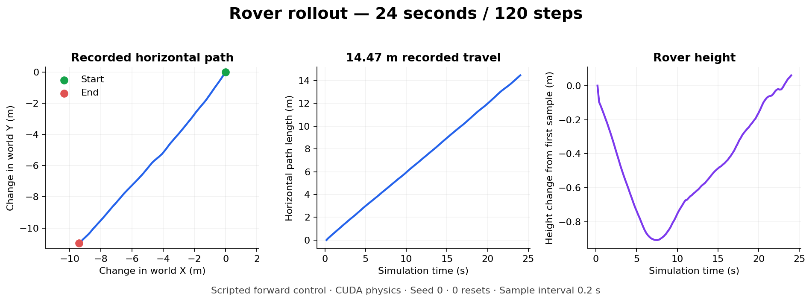
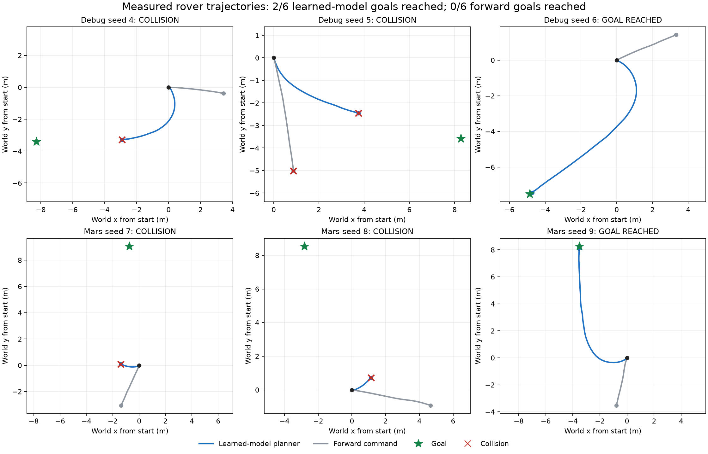
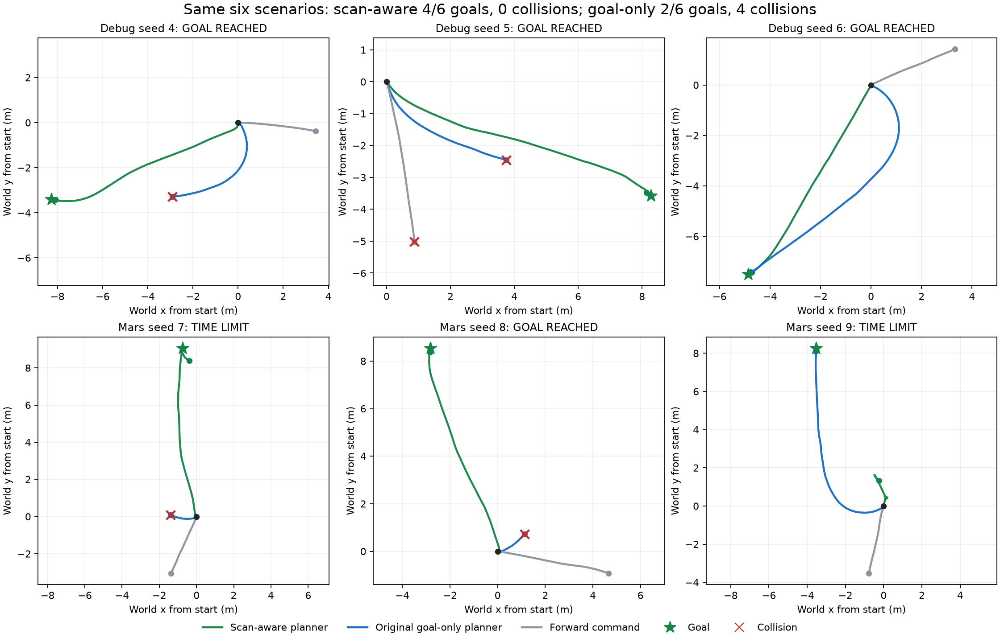
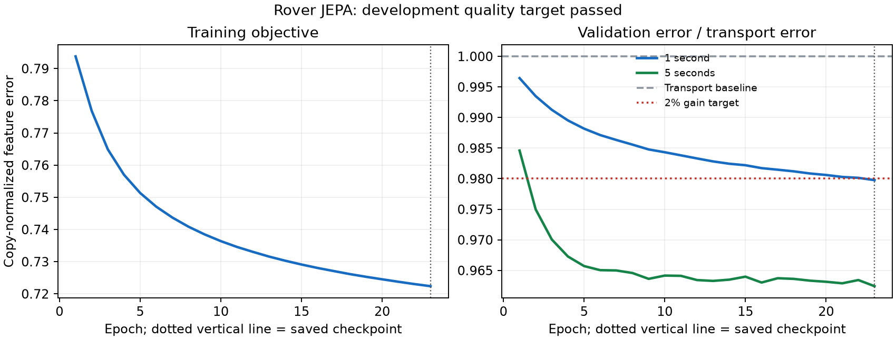

# Results and evidence

The trained goal-motion model now runs in a closed feedback loop with Isaac Sim.
The scan-aware planner reached four of six native goals with no collisions on
the original cases and on six fresh cases. The original planner reached two
goals in each set; forward motion reached none. The checkpoint is unchanged.
Two scan-aware cases in each set still timed out.

## Rover motion

The recorded run used `AAURoverEnvSimple-v0`, seed 0, and a scripted forward
command on an NVIDIA A40. It completed on 2026-11-06 UTC.

| Measurement | Value |
| :--- | ---: |
| Recorded steps | 120 |
| Simulated time | 24.0 s |
| Horizontal path between recorded samples | 14.46758 m |
| Net horizontal displacement | 14.43832 m |
| Resets | 0 |
| RGB frames | 0 |



This demonstrates motion and position recording under one scripted command.
It does not measure learned control, prediction accuracy, collision avoidance,
or generalization to new terrain. Camera startup stalled. The saved replay is
a top-down animation of measured positions.

Evidence copied into the documentation:

- [Recorder summary](results/summary.json)
- [Motion metrics](results/motion-metrics.json)
- [Run history](../notes/setup.md)

Full local artifacts are in `runs/rover-video/`: `trajectory.csv`,
`trajectory.png`, `trajectory-replay.mp4`, and the JSON summaries. These generated
files are ignored by Git; the small documentation copies above are included.
The persistent cluster copy is under `/data/runs/rover-video/`.

The earlier independent rover check also completed 120 headless steps with exit
code 0. Its pod was `mars-rover-smoke-rz474` on `bak-hpc1.csub.edu`.

## Rover training data

On 2026-11-13 UTC, Job `mars-rover-training-data` completed on an RTX A6000
with exit code 0. RLRoverLab's recorder saved 600 action-conditioned transitions
in four HDF5 episode groups: 122, 72, 350, and 56 transitions. Each group has
matching action, observation, next-observation, reward, and done lengths. The
first three groups end with `done=true`; the last is a partial episode.

The dataset is on the cluster at
`/data/datasets/rover/mars-rover-training-data-tds6k/rover_seed_0.hdf5` and
locally at `data/rover/rover_seed_0.hdf5` (29 MiB, ignored by Git). It records
the simple task's policy state and height scan, not RGB or wheel slip labels.
One seed and terrain are enough to check the training input path, but not to
measure generalization. The local predictor below is only a training check.

## First local training check

`scripts/train_rover_baseline.py` trained a small action-conditioned MLP on
three episode groups (541 adjacent transitions) and held out the fourth (55
transitions). It uses consecutive policy observations because the recorded
`next_obs` keeps three goal fields stale. The 32-transition fit reached MSE
0.000119, below its copy-observation baseline of 0.001689, so the loader and
optimizer can fit data. The held-out MSE was 0.007216, above the copy baseline
of 0.000834. Shuffling validation actions changed MSE only to 0.007220.
This model has not learned a useful general rover predictor; the dataset needs
more varied runs before model quality can be assessed.

The local checkpoint and full metrics are under `runs/rover-baseline/` and are
ignored by Git. Re-run instructions are in [getting started](getting-started.md#train-the-first-rover-baseline-locally).

The six-run `mars-rover-variation` Job was submitted on 2026-11-13 UTC for
three new seeds on each of the `mars` and `debug` terrains. On resuming work,
indices 0 and 1 had completed. Their seed-1 recordings each contain 900 rows in
three episode groups. Local checks confirmed matching field lengths, finite
observations and actions, episode boundaries, and forward, reverse, stop, and
turn coverage. Index 3 has since completed with 900 rows on seed-2 debug
terrain in two episode groups (568 and 332 rows). It passed the same checks.
The total is now 3,300 recorded rows across four runs; the sweep is 3/6 complete.

## Earlier expanded full-vector baseline

The earlier baseline accepted several training files and separate validation files.
It trained on Mars seeds 0 and 1 (1,493 adjacent transitions) and held out all
of the seed-1 debug run (897 transitions). It kept the existing model and training
schedule. This is a validation split between terrains, not a separate final test.

| Check | Predictor MSE | Copy-observation MSE |
| :--- | ---: | ---: |
| Tiny batch | 0.000119 | 0.001689 |
| Held-out one-step | 0.003541 | 0.002200 |
| Held-out five-step | 0.049909 | 0.011980 |
| Held-out goal fields | 0.006664 | 0.004760 |
| Held-out height scan | 0.003538 | 0.002197 |

The model still fails to beat copying. Shuffling actions gives one-step MSE
0.003541, which shows little measured action use. The overall score includes
the previous command; the separate goal and scan scores exclude it. These
observations do not provide direct velocity or wheel-slip labels.

[Saved metrics](results/rover-baseline.json) preserve the run inputs and scores.
The local checkpoint is in `runs/rover-baseline/20261113T204800349745Z/`.
Five-step evaluation never crosses an episode boundary.

## Corrected goal-motion baseline

The earlier full-vector model gave over 10,000 scan values the same weight as
three goal fields. Its angle loss also treated crossing the ±π boundary as a
large jump. The first transition after reset can contain an uninitialized goal:
the first recording starts with the command generator's default `(1, 1)` target
vector rather than its sampled goal. The loader now omits the first transition
of every episode and checks that each next observation contains the applied
command in its previous-action fields.

The replacement learns movement in the rover frame from current and previous
commands. It converts predicted movement into goal distance, bearing, and
heading error. All three motion targets use scales fitted on training data.
Angular differences wrap at ±π. Forward and lateral movement are both free to
vary; there is no no-slip constraint. The model does not use or predict terrain.

The run trained on Mars seeds 0 and 1 (1,486 transitions), validated on debug
seed 1 (894), and scored held-out debug seed 2 (896). Each model completed 1,000
training steps. Both command and no-command models started from the same seed.

| Goal error (MSE) | Model | Copy current goal fields | Model without commands |
| :--- | ---: | ---: | ---: |
| Validation, one step | 0.00001918 | 0.00003222 | 0.00003218 |
| Validation, five steps | 0.00038808 | 0.00066456 | 0.00066551 |
| Seed 2, one step | 0.00001462 | 0.00003204 | 0.00003266 |
| Seed 2, five steps | 0.00030272 | 0.00067453 | 0.00069138 |

Seed-2 error is 54% lower than copying at one step and 55% lower at five steps.
Shuffling its current commands raises one-step error to 0.00002809. All three
goal fields improve over copying when scored separately. The tiny-batch error
is 0.00000106 versus 0.00004253 for copying.

[Saved metrics](results/rover-goal-motion.json) include inputs, field definitions,
package versions, and both model evaluations. The checkpoint, no-command
checkpoint, and source copy are under
`runs/rover-baseline/20261113T210435968626Z/`. Reloading the saved model reproduced
the seed-2 score.

These are errors on scaled goal fields. They cannot be compared directly with
the earlier full-vector scores, which used different targets and reset handling.
The seed-2 recording stayed out of training, but was inspected during development;
a fresh final test is still needed. Goals must remain fixed inside each episode.
Motion targets come from goal geometry, not independent simulator motion labels.
Terrain response and wheel slip remain untested. Closed-loop navigation results
are recorded below.

## End-to-end rover navigation

On 2026-11-13 UTC, the trained `goal-motion-v1` checkpoint controlled
`AAURoverEnvSimple-v0` in headless Isaac Sim on an RTX A6000. The planner predicted
candidate commands with the learned model and replanned after every physics
control step. It received policy goal state and commands; world poses were used
only to measure outcomes. No target was moved and no termination was disabled.

Native success requires distance below **0.18 m** and heading error below
**0.1 rad**. Both successful episodes passed that native check and a separate
check against the measured terminal pose before the simulator reset the rover.

| Terrain / seed | Model result | Final distance | Final heading error | Forward result |
| :--- | :--- | ---: | ---: | :--- |
| Debug / 4 | Collision | 5.360 m | 2.939 rad | Far from goal |
| Debug / 5 | Collision | 4.675 m | 1.353 rad | Collision |
| Debug / 6 | **Goal reached** | **0.152 m** | **0.072 rad** | Far from goal |
| Mars / 7 | Collision | 8.986 m | 0.209 rad | Far from goal |
| Mars / 8 | Collision | 8.764 m | 2.607 rad | Far from goal |
| Mars / 9 | **Goal reached** | **0.164 m** | **0.048 rad** | Far from goal |

The Mars success reduced distance from 8.984 m to 0.164 m in 219 control steps
(**43.8 simulated seconds**, plus 1 s of settling). Its measured horizontal path
was 10.797 m. It had no collision. The matched forward run ended 12.098 m away.
The debug success took 260 control steps (52 s) with no collision.

| Controller | Goals reached | Collisions | Mean debug progress | Mean Mars progress |
| :--- | ---: | ---: | ---: | ---: |
| Learned-model planner | 2 / 6 | 4 / 6 | +5.571 m | +3.053 m |
| Scripted forward | 0 / 6 | 1 / 6 | −1.616 m | −3.070 m |



Each controller pair had identical measured initial pose and goal. Joints reset
to default position and zero velocity; five zero-command settling steps preceded
control. This fixed the upstream reset's retained joint motion. The final
alignment phase uses zero forward speed, a shorter prediction horizon, and
hysteresis to avoid switching repeatedly back to approach control.

Both evaluation commands exited with code 0 and wrote their own `SUCCESS`
markers. An independent CSV check recomputed goal distances, heading errors,
path lengths, command bounds, collisions, and success counts. It checked paired
initial states and the saved checkpoint hash. The executed source copies are
saved; at that evaluation, the repository source had the same Python syntax tree.

Saved evidence:

- [Debug results](results/rover-navigation-debug-v2.json).
- [Mars results](results/rover-navigation-mars-v2.json).
- [Independent verification](results/rover-navigation-verification.json).
- [Runtime stack and dependency warnings](results/rover-navigation-stack.json).
- [Deployment and evaluation guide](../deploy/nautilus-navigation/README.md).

Local raw traces, logs, checkpoint, source, and package versions are under
`runs/rover-navigation/{debug-v2,mars-v2,runtime-v2,setup-v2}/`. The plot source is
`runs/rover-navigation/plot.py`. Persistent cluster results are under:

```text
/data/runs/rover-navigation/mars-rover-navigation-session-42bhl/
/data/runs/rover-navigation-mars-v2/mars-rover-navigation-session-42bhl/
/data/runs/rover/mars-rover-navigation-session-42bhl/
/data/runs/setup/mars-rover-navigation-session-42bhl/
```

These evaluations used a bounded diagnostic GPU session. It was stopped after
both commands completed and artifacts were copied. The standalone v2 Job
manifests pass server-side validation. Their wrapper now requires the evaluator's
success marker: Isaac shutdown can otherwise mask a Python error with exit code
zero. The initial v1 attempts did not pass the complete evaluation; their Job
status alone is not evidence of navigation success.

This early result did not establish reliable navigation. That planner had no
height-scan or obstacle input, and four collisions show that limit. RGB capture,
wheel-slip estimation, a rover JEPA encoder, and general terrain response remain
unfinished. Runtime package checks also reported upstream version conflicts;
the exact working versions and warnings are saved, rather than claimed clean.

## Scan-aware navigation

The follow-up completed on 2026-11-14 UTC. It keeps the trained motion model
and native success checks. It adds routing from the rover's policy height scan.
Raised areas, sharp height changes, and unknown cells block predicted paths.
The planner adds clearance for the rover and follows a local route. It stops
when none of the candidate paths pass these checks. It uses no privileged
obstacle geometry. Simulator poses measure outcomes only.

| Cases | Controller | Goals reached | Collisions |
| :--- | :--- | ---: | ---: |
| Original six, seeds 4–9 | Scan-aware | **4/6** | **0/6** |
| Original six, seeds 4–9 | Original goal-only | 2/6 | 4/6 |
| Original six, seeds 4–9 | Forward | 0/6 | 1/6 |
| Fresh six, seeds 10–15 | Scan-aware | **4/6** | **0/6** |
| Fresh six, seeds 10–15 | Original goal-only | 2/6 | 3/6 |
| Fresh six, seeds 10–15 | Forward | 0/6 | 5/6 |




The original cases were used to select the planner. Source, parameters, and
checkpoint were then frozen before the fresh runs. No fresh result was used
to tune the planner. Both fresh Jobs completed, wrote `SUCCESS` markers, and
saved exit code 0. The saved source and checkpoint hashes match the test plan.
The checkpoint SHA256 is
`76953ac81e383a6000d9b26bf8026b5049f4ce768831bd48506dea31d7649283`.

Independent trace checks passed for all four terrain/set combinations. They
recomputed goal distance, heading error, path length, command bounds, collision
counts, and goal counts. All three controllers started from identical measured
states. Success still requires distance below 0.18 m, heading error below
0.1 rad, and no collision. No termination was disabled.

Scan-aware goals were seeds 4, 5, 6, 8, 10, 11, 13, and 14. Seeds 7, 9, 12,
and 15 timed out without collision. The original planner succeeded on seeds
9 and 12, so the new planner does not improve every case. Local routing can
stall near tight goals. Height thresholds do not guarantee hazard detection.
These are small samples on the same two terrain layouts; they do not establish
safety or performance on new layouts.

Saved evidence:

- [Frozen test plan and hashes](results/rover-navigation-scan-test-plan.json).
- [Validation debug](results/rover-navigation-scan-validation-debug.json) and
  [validation Mars](results/rover-navigation-scan-validation-mars.json).
- [Fresh debug](results/rover-navigation-scan-fresh-debug.json) and
  [fresh Mars](results/rover-navigation-scan-fresh-mars.json).
- [Aggregate results and independent verification](results/rover-navigation-scan-verification.json).
- [Deployment and evaluation guide](../deploy/nautilus-navigation/README.md).

Raw CSV traces, scans, and verification are under
`runs/rover-navigation/{scan-v3-debug,scan-v3-mars,scan-v4-fresh-debug,scan-v4-fresh-mars}/`.
Fresh folders also hold runtime and setup logs, source copies, package versions,
and exit codes. The shared cluster volume retains the full artifacts.
No retraining, RGB capture, or rover JEPA encoder work was needed for this change.

## Rover JEPA training

The rover now has an actual JEPA-WMs training path. It uses Meta's frozen,
pretrained DINOv2 ViT-S/14 encoder and the upstream DINO-WM `ViTPredictor`.
Height scans replace RGB images. The predictor starts with random weights;
no PointMaze motion checkpoint is transferred.

The first two runs failed the action-use check. Later runs reduced predictor
size, added a frozen motion prior, aligned past feature maps, corrected the
raster scale, and balanced loss across forecast horizons. The current model
has 167,904 trainable parameters. All feature scores use the original 384
encoder features. Pose scores come from the frozen motion baseline.

Run v11 used all four new training recordings and stopped at a validation
plateau after 17 epochs. It selected epoch 16. It narrowly missed the fixed
target: one-second validation gain over transport was 1.83%, below 2%.
All other development checks passed.

| Development split | Horizon | Gain over copying features | Gain over motion-only transport |
| :--- | ---: | ---: | ---: |
| Validation | 1 s | 10.41% | 1.83% |
| Validation | 5 s | 21.83% | 3.61% |
| Development test | 1 s | 13.95% | 2.26% |
| Development test | 5 s | 26.08% | 5.22% |

The collection Job completed 18,000 new simulation rows. Training uses 12,000
of them plus 4,200 original rows. The remaining 6,000 new rows, Mars seed 20
and debug seed 21, stay reserved. Development validation and test each have
900 original rows. These are two existing terrain layouts, not unseen layouts.
The collector uses scripted exploration; it does not train an RL policy.

Run v12 repeated the source and split. It passed every development check at
epoch 23. Validation feature gains over copying were 10.59% at one second
and 21.95% at five seconds. Gains over transport were 2.02% and 3.76%.
The development-test gains over copying were 14.11% and 26.03%; gains over
transport were 2.44% and 5.16%. Numerical differences changed the training
path between runs. The one-second validation margin remains narrow.
The reserved final evaluation completed on this frozen checkpoint. It first
verified source and encoder hashes and independently replayed development
validation on a GPU. It then opened Mars seed 20 and debug seed 21 for the
first time. No model or projection fitting used these recordings.

| Final split | Horizon | Gain over copying features | Gain over motion-only transport |
| :--- | ---: | ---: | ---: |
| Pooled, 1,135 windows | 1 s | 10.80% | 2.37% |
| Pooled, 1,135 windows | 5 s | 19.88% | 5.65% |
| Mars seed 20, 565 windows | 1 s | 9.85% | 2.06% |
| Mars seed 20, 565 windows | 5 s | 18.72% | 4.28% |
| Debug seed 21, 570 windows | 1 s | 11.63% | 2.64% |
| Debug seed 21, 570 windows | 5 s | 21.00% | 6.96% |

The planned pooled final target passed. Shuffling future commands increased
pooled feature error by 11.81% at one second and 7.47% at five seconds. Pose
error was about half the copy baseline error; those pose forecasts come from
the frozen motion prior. Mars alone narrowly missed the 10% one-second copy
gain target. The gain varies by terrain, and no unseen-layout claim is made.
All training, collection, and final-evaluation workloads have completed.

These results measure offline prediction. They do not establish closed-loop
JEPA navigation or safety.



Evidence and procedure:

- [Frozen final-test report](results/rover-jepa/final-metrics.json).
- [Selected run v12 metrics](results/rover-jepa/attempt-10-metrics.json),
  [manifest](results/rover-jepa/attempt-10-manifest.json), and
  [checkpoint verification](results/rover-jepa/attempt-10-verification.json).
- [Collection completion report](results/rover-jepa/collection.json).
- [Baseline trained on the selected split](results/rover-jepa/selected-baseline-metrics.json).
- [Run v11 metrics](results/rover-jepa/attempt-9-metrics.json),
  [manifest](results/rover-jepa/attempt-9-manifest.json), and
  [history](results/rover-jepa/attempt-9-history.jsonl).
- [Reserved test plan](results/rover-jepa/test-plan.json).
- [Training and collection guide](../deploy/nautilus-jepa-rover/README.md).

## Reference planning

The first Step 1 deployment failed during setup, before checkpoint loading,
dataset inspection, or planning. Job `mars-jepa-step1` ran pod
`mars-jepa-step1-4dg8d` on `k8s-gpu-1.ucsc.edu`.

The pinned JEPA project requests Metaworld from the Git branch `master`.
The upstream repository no longer provides that branch:

```text
fatal: couldn't find remote ref refs/heads/master
```

The runtime installer now pins a compatible Metaworld commit and overrides
`datasets`. These changes still need a full reference run. The existing deploy
script refuses to replace a job. Review the failed job and its logs before
removing it. Keep the shared volume.

```bash
rtk kubectl --context nautilus -n razvanlab logs job/mars-jepa-step1 -c setup
rtk kubectl --context nautilus -n razvanlab get job mars-jepa-step1
```

The setup log is saved under
`/data/runs/setup/mars-jepa-step1-4dg8d/install.log`. No planning success rate is
available from this run.

The configured evaluation uses two episodes, seed 0, three planning iterations,
and 32 candidate action sequences per iteration. Optional decoder heads are
disabled. This is a small functional check; it is not the full paper benchmark.
See the [Step 1 guide](../deploy/nautilus-reference/README.md) for expected outputs.

## Local validation

After the scan-aware navigation work, 26 unit tests passed. These include scan
geometry validation, blocked-path checks, local routing, and the real pinned
gdown CLI, action timing, angle wrapping, coordinate conversion, checkpoint
reload, synthetic dynamics training, closed-loop planning, and preservation of
failure exit codes through simulator shutdown. The repaired reference job also passed
server-side validation and its shell scripts passed syntax checks.

At the original Step 1 deployment, 10 unit tests passed. The three Step 1 Python files parsed,
the two new shell scripts passed syntax checks, and Nautilus accepted the job
in server-side validation. These checks cover deployment structure and helper
behavior. They do not establish model or navigation performance.
